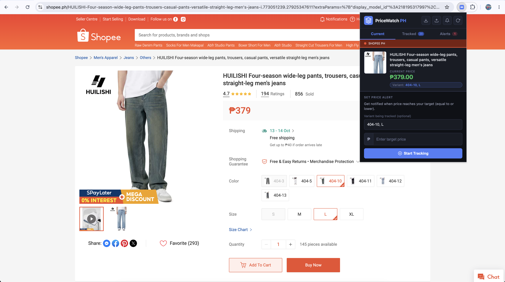
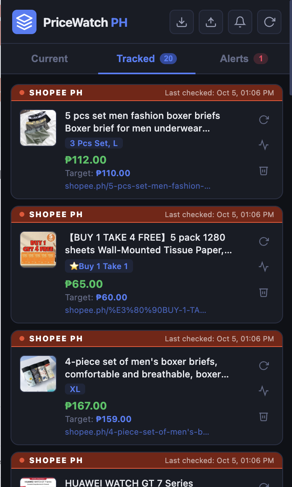
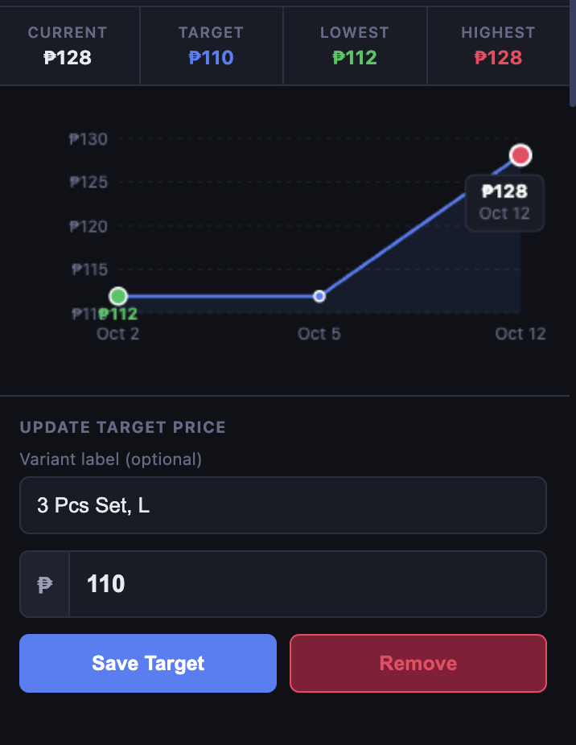

# PriceWatch PH – Chrome & Edge Extension


[](#ai-disclosure)

A privacy-first price monitoring browser extension for **Shopee Philippines** and **Lazada Philippines**. Built as a group thesis project for the BS Computer Science program at Holy Angel University.

It reads the product name, image, and price straight from the page, lets you track a *specific variant* (size / colour / bundle), and notifies you when the price drops or rises to your target. Everything stays on your device: there is no server and no account.

**[Get it on the Chrome Web Store](https://chromewebstore.google.com/detail/dkdiglbjkpgfekjnbcjlodnaggmnoopc)**

## Screenshots

<table><tr><td align="center"><br><sub>Current tab</sub></td><td align="center"><br><sub>Tracked tab</sub></td><td align="center"><br><sub>Price history</sub></td></tr></table>

---

## Features

- **Automatic platform detection** – Detects whether you're on Shopee PH or Lazada PH
- **Product extraction** – Reads the product name, image, and current price from the page using DOM parsing
- **Variant-aware tracking** – Tracks a specific size/colour/bundle variant (not just the product as a whole), and shows which variant is being tracked in both the Current and Tracked views
- **Price alerts** – Set a target price and choose to be notified when the price drops to OR rises to that level
- **Bonus drop alert** – Get an alert when a tracked price drops by 5% or more, even if it did not reach your target
- **Background monitoring** – Checks prices hourly even when you're not on the product page
- **Price history** – Stores up to 30 days of price records per product
- **Export** – Download all tracked products and history as JSON or CSV
- **100% private** – All data stored locally on your device; nothing is sent to any server

---

## Installation

### Chrome

1. Open the [Chrome Web Store page](https://chromewebstore.google.com/detail/dkdiglbjkpgfekjnbcjlodnaggmnoopc).
2. Click **Add to Chrome**.
3. Click **Add extension**.
4. Click the puzzle icon in the toolbar, then click the pin next to PriceWatch PH.

### Microsoft Edge

1. Open the same [Chrome Web Store page](https://chromewebstore.google.com/detail/dkdiglbjkpgfekjnbcjlodnaggmnoopc) in Edge.
2. If Edge asks, click **Allow extensions from other stores**.
3. Click **Add to Chrome**, then **Add extension**.

---

## Run with Docker

This runs the extension inside a Chromium browser in a Docker container. You do not need to install the extension by hand. This is for testing and demos. Most users should install from the Chrome Web Store.

- Docker image: https://hub.docker.com/r/darsy29/pricewatch-ph
- Version: 2.2.4
- Works on Windows, Mac (Apple Silicon and Intel), and Linux

### What you need

- Docker Desktop: https://www.docker.com/products/docker-desktop
- An internet connection
- Any browser to open the container screen

### Option 1: Run from Docker Hub

1. Open Docker Desktop. Wait until it says "Engine running".
2. Open Terminal (Mac) or PowerShell (Windows).
3. Run this one line:

```
docker run -d --name pricewatch-ph -p 3100:3000 -p 3101:3001 --shm-size=1gb --security-opt seccomp=unconfined -e TZ=Asia/Manila darsy29/pricewatch-ph:2.2.4
```

4. Wait 30 seconds.
5. Open https://localhost:3101 in your browser.
6. If you see a certificate warning, click Advanced, then Proceed. The certificate is local, so the warning is normal.

### Option 2: Build from the source code

1. Open Docker Desktop. Wait until it says "Engine running".
2. Run these lines. If you already have the `Price-Tracker` folder, skip the first two lines and open the folder in Terminal.

```
git clone https://github.com/rnzcrt/Price-Tracker.git
cd Price-Tracker
docker compose up -d --build
```

3. Wait 30 seconds.
4. Open https://localhost:3101 in your browser. Accept the certificate warning as in Option 1.

Use only one option at a time. If you get a name error, run `docker rm -f pricewatch-ph` and try again.

### Check that the extension works

1. In the container window, go to `chrome://extensions`.
2. Check that PriceWatch PH 2.2.4 is there and turned on.
3. Click the puzzle icon and pin PriceWatch PH.
4. Open a product page on shopee.ph or lazada.com.ph.
5. Click the PriceWatch PH icon.
6. Enter your target price and click Start Tracking.
7. Open the Tracked tab to see your item and the price history.

### Keep your data

Option 1: add this to the `docker run` line, before the image name:

```
-v pricewatch-data:/config
```

Option 2: your data is saved in the `browser-data` folder.

The container must stay running for the hourly price checks.

### Stop it

Option 1:

```
docker rm -f pricewatch-ph
```

Option 2:

```
docker compose down
```

### If something does not work

- Blank screen: wait 30 seconds, then refresh. Use https and port 3101.
- Port is busy: change the left number of the port. For example, use `3200:3000` and `3201:3001`. Then open https://localhost:3201.
- Extension not showing: run `docker exec pricewatch-ph printenv CHROME_CLI`. It should show `--load-extension=/opt/pricewatch-ph`.
- Shopee shows a login or captcha: try a different product, or try Lazada.

---

## How to Use

1. Open a product page on **shopee.ph** or **lazada.com.ph**.
2. If the product has sizes, colours, or bundles, pick the one you want first.
3. Click the **PriceWatch PH** icon in your toolbar.
4. The extension shows the product name, image, and price. Check that they are right.
5. Type your **target price**.
6. Choose one:
   - **Notify when price drops to** – get alerted when the price goes down to your target
   - **Notify when price rises to** – get alerted when the price goes up to your target
7. Click **Start Tracking**.
8. You get a browser notification when the price hits your target. You also get an alert when a tracked price drops by 5% or more.

### Managing Tracked Products

- Click the **Tracked** tab to see all the products you track. The price history chart is there too.
- Click ✕ on a product to stop tracking it.
- Click the **export button** (↓ icon in the header) to download your data as JSON or CSV.
- Keep Chrome open. The hourly price checks only run while the browser is running.

### Variant Tracking

Many Shopee and Lazada products come in several sizes, colours, or bundles, each with its own price. PriceWatch PH tracks a _specific_ variant rather than the product as a whole:

- **Lazada** already encodes the chosen variant in the product URL, so opening a product page with a variant selected and tracking it just works — the exact URL is what gets re-checked later.
- **Shopee** does not put the variant in the URL, so the extension instead remembers exactly which option(s) were selected when the product was tracked (e.g. "grey", "M") by reading Shopee's own selection markup. On every later refresh, it re-selects those same options — the same buttons a shopper would click by hand — before reading the price, rather than trusting whichever variant the page shows by default. Shopee's item data (the same internal request already used to read the price — see _Ethical Considerations_ in the thesis) is also cross-checked as a secondary source for the variant's internal ID.
- An optional **variant label** field (e.g. "Red, XL") is auto-filled when detectable and shown in both the **Current** and **Tracked** views; it can be edited freely, since automatic detection of the on-page label is best-effort and depends on each platform's current page layout.
- Two different variants of the same Shopee product (same URL) can be tracked as separate items, consistent with treating each product variation as its own tracked entry.

---

## Technical Architecture

| Component          | Technology                                  |
| ------------------ | ------------------------------------------- |
| Platform detection | URL pattern matching                        |
| Price extraction   | Tree-based DOM parsing with CSS selectors   |
| Price cleaning     | Rule-based normalization (strips ₱, commas) |
| Alert logic        | Threshold comparison algorithm              |
| Data storage       | `chrome.storage.local` (IndexedDB-backed)   |
| Background checks  | Chrome Alarms API + Service Workers         |
| Notifications      | Chrome Notifications API                    |

---

## Limitations

- Only works on **Shopee PH** (shopee.ph) and **Lazada PH** (lazada.com.ph)
- Requires the browser to be open for background checks to run
- If Shopee or Lazada updates their page layout, the CSS selectors may need to be updated
- Cannot read prices hidden behind login walls or captchas
- Does **not** track shipping fees, stock availability, or seller ratings
- Data is device-specific and does not sync across browsers/devices
- Auto-detected variant labels are best-effort; if a platform's page layout changes, the label may need to be entered manually (the tracked price itself is not affected by this)
- If two variants of the same Shopee item happen to share the exact same price at the moment it's tracked, the extension can't tell them apart by price alone; it still tracks the correct price shown on screen, but re-checks may default to whichever variant the page shows first
- On the **Current** tab, Shopee prices mirror exactly what's shown on the page: if no variant is selected yet and the page shows a price range (e.g. "₱1,000 – ₱2,000"), the Current tab shows that same range rather than picking one number for you — track a specific variant first if you want a single tracked price
- On Shopee, the price read from the page is cross-checked with Shopee's item data (see _Ethical Considerations_). If the page briefly shows a voucher, shop discount, or delivery badge instead of the real price, the number from the item data is used instead

---

## Privacy

- No data is transmitted to any external server
- All prices, product URLs, and settings are stored only on your local device
- No personal information is collected
- You can export and delete all your data at any time
- Privacy policy: https://github.com/WrathFury09/Privacy-Policy-PriceWatch/blob/main/privacy-policy.md

---

## Files

```
Price-Tracker/
├── manifest.json          # Extension manifest (Manifest V3)
├── popup.html             # Extension popup UI
├── Dockerfile             # Builds the Docker image
├── docker-compose.yml     # Runs the Docker container
├── .dockerignore          # Files Docker skips
├── config/
│   └── selectors.json     # Platform-specific CSS selector profiles
├── css/
│   └── popup.css          # Popup styles
├── js/
│   ├── popup.js           # Popup controller
│   ├── content.js         # DOM extraction (runs on product pages)
│   ├── background.js      # Service worker (alarms, notifications)
│   ├── db.js              # Storage helper
│   └── chart.js           # Price history line chart renderer
├── icons/
│   ├── icon16.png
│   ├── icon48.png
│   └── icon128.png
└── docs/
    └── screenshots/       # README images
```

---

## Team

- [Ranz Emmanuel Cuarto](https://github.com/rnzcrt)
- [Mark Darius David](https://github.com/darsy29)
- [Rian Cortez](https://github.com/riancrtz)
- [Ryence Cortez](https://github.com/Ryence07)

## AI disclosure

Parts of this project and its documentation were created with AI assistance. This README was drafted with Claude (Anthropic) and reviewed by me.
